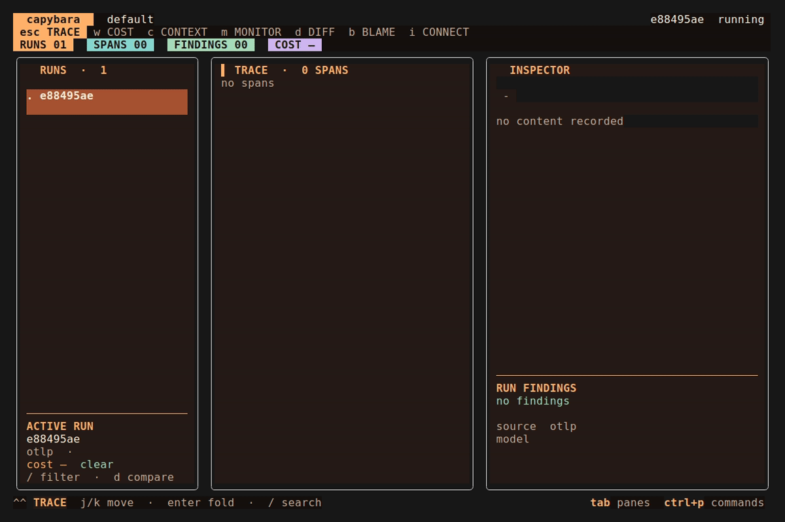
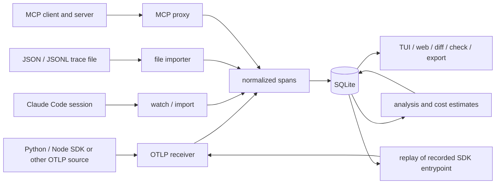

<p align="center">
  
</p>

<h1 align="center">capybara</h1>

<p align="center">
  A terminal trace debugger for AI agents.<br>
  It records agent traces so you can inspect failures, tool calls, and costs.
</p>

<p align="center">
  <a href="https://github.com/tonquoc0407/capybara/releases"></a>
  <a href="https://github.com/tonquoc0407/capybara/actions"></a>
  <a href="go.mod"></a>
  <a href="LICENSE"></a>
</p>

<p align="center">
  
</p>

## Contents

- [Install](#install)
- [Getting a trace in](#getting-a-trace-in)
- [Reading a trace](#reading-a-trace)
- [What it looks for](#what-it-looks-for)
- [Other commands](#other-commands)
- [Config](#config)
- [Architecture](#architecture)

## Install

```sh
brew install tonquoc0407/tap/capybara
```

Or `go install github.com/tonquoc0407/capybara/cmd/capybara@latest`, or grab a binary from the [releases page](https://github.com/tonquoc0407/capybara/releases). One file, no CGo, no runtime dependencies.

## Getting a trace in

Run it with no arguments. It opens the TUI, listens for OTLP on `127.0.0.1:4318` and `127.0.0.1:4317`, and tails `~/.claude/projects` when that directory exists:

```sh
capybara
```

Traces land in `capybara.db` in the working directory. Point somewhere else with `-db`. Use `-no-content` to omit prompt, completion and tool bodies and to keep only selected numeric and status attributes from raw telemetry. Names, IDs and other structured metadata can still contain sensitive text if your instrumentor puts it there. The flag does not erase existing runs; use a new database or remove old data separately. Use `-no-claude` to disable the automatic Claude Code watcher in the TUI. With an empty database, the middle pane shows what it's listening on and how to send it something.

To inspect a labelled synthetic failure immediately, run `capybara sample` against the same database, then reopen the TUI or Web view. The sample is idempotent and its `demo` environment distinguishes it from live traffic.

If something else already holds 4317 or 4318 — a collector, Jaeger, another tracing UI — capybara keeps the transport that did bind, reports which one it lost, and carries on. `-otlp 127.0.0.1:4319` moves the HTTP listener somewhere free.

There are three ways in, and one database can hold all of them.

### OTLP

Point any instrumented app at it:

```sh
OTEL_EXPORTER_OTLP_ENDPOINT=http://127.0.0.1:4318
```

Four attribute conventions are read — OpenTelemetry's own `gen_ai.*`, OpenInference (Arize/Phoenix), OpenLLMetry (traceloop), and the Vercel AI SDK's legacy `ai.*` — so whichever instrumentor you already run is enough.

If LiteLLM is already your gateway, use the [LiteLLM OTLP setup](docs/integrations/litellm.md) to feed its traces into capybara without placing capybara in the request path.

[`demo/frameworks/`](demo/frameworks) has two runnable agents that end in the same failure — a LangGraph one traced by OpenLLMetry and a plain OpenAI tool loop traced by OpenInference. Both point at a local stub of the OpenAI API, so they need no key.

Below, the LangGraph one runs while the TUI is open: the quote tool raises, LangGraph hands the failure back to the model, and the model answers with a price anyway.

<p align="center">
  
</p>

The next recording uses a separate LangChain chess agent. The demo script adds tracing outside that agent and shows token costs estimated from Gemini's reported usage.

<p align="center">
  
</p>

### A session file

```sh
capybara watch claude
```

Tails Claude Code's own logs. No instrumentation, no restart — it reads what's already on disk.

### A file you have

```sh
capybara import trace.jsonl
```

Takes span-per-line JSONL, or agent-replay JSON when the name ends in `.json`. Use `capybara import --format otlp-jsonl traces.jsonl` for standard OTLP `resourceSpans` JSONL, or `capybara import --format claude-jsonl session.jsonl` to backfill an older Claude Code session. OTLP LogRecords are not imported as traces. [`scripts/langfuse_export.py`](scripts/langfuse_export.py), [`scripts/phoenix_export.py`](scripts/phoenix_export.py), [`scripts/langsmith_export.py`](scripts/langsmith_export.py) and [`scripts/weave_export.py`](scripts/weave_export.py) each produce span JSONL from a trace already sitting in those services.

### From your own agent

For a local app without an SDK, press `i` in the TUI and select **HTTP JSON events**. The listener accepts `POST /api/v1/events` on the same local HTTP address as OTLP (normally `http://127.0.0.1:4318`). Run [`examples/local_events.py`](examples/local_events.py) or [`examples/local_events.mjs`](examples/local_events.mjs) for a live start, update and end. Set `CAPYBARA_EVENTS_URL` if the listener was moved with `-otlp`.

For a long-running local service without a terminal UI, run `capybara listen`. It prints the bound HTTP events and OTLP endpoints, stores incoming spans, and runs the same analyzer. `capybara -otlp 127.0.0.1:4319 listen` moves its HTTP port.

Each request needs a unique `event_id`, `type`, `run_id`, `span_id` and RFC3339 `time`. `span.start` needs `kind` and `name`; `span.end` needs `status` (`ok` or `error`). `span.complete` can send a finished span in one request, with optional `start_time`. Retries with the same event ID and body are safe. An update or end before start returns HTTP 409. The receiver stores `model`, `provider`, `tool_name`, `tokens_in`, `tokens_out`, `cost_usd`, `attrs` and `contents` when provided. `-no-content` drops content bodies and untrusted attributes. The endpoint accepts requests from the same machine only; it has no API key.

The TUI also lists OTLP, both SDKs, the Claude watcher and file import under `i`.

Install the Python SDK:

```sh
pip install capybara-sdk
```

```python
import capybara

capybara.init()  # export to a local capybara on 127.0.0.1:4318


@capybara.trace(tool="lookup_price")
def lookup_price(sku: str) -> dict:
    return {"price": 42.0, "currency": "USD"}
```

`init()` reuses a `TracerProvider` you already configured, so any instrumentor you already run keeps working — capybara only adds an exporter to it.

The same three calls exist for Node in [`sdk-js/`](sdk-js): `init`, `trace`, `schema`. The Node package is currently installed from a local source build; it is not published on npm.

## Reading a trace

The tree marks `x` for a failed span, `!` for one carrying a finding, and `?` for one nothing ever came back from. The run column shows when each run started, what it cost, and what was recorded against it.

| Key | Action | Key | Action |
| --- | --- | --- | --- |
| `j` / `k` | move | `w` | cost waterfall |
| `enter` | expand | `d` | diff two runs |
| `/` | search | `c` | context view |
| `tab` | change pane | `b` | blame the output |
| `f` | filter by kind | `r` | re-run from a span |
| `a` | raw attributes | `t` | export a pytest case |
| `e` | edit a tool output | `y` / `Y` | copy content / curl |
| `q` | quit | `?` | full help |
| `m` | resource monitor | | |
| `ctrl+p` | search commands | `space` in detail | full-screen detail |

The TUI uses three panes on wide terminals, two on medium ones, and one on narrow ones. Arrow keys work alongside `j/k`. There is no timed splash screen.

The waterfall sorts spans by cost, so the turn that spent the money is the first line rather than something to scroll for. The context view shows what filled each turn's window — system text, tool output, history — and marks the turns where it dropped, which is where a compaction ate something.

The monitor graphs process CPU and memory, plus GPU where `nvidia-smi` finds a card, against the node that was running. It reads the sampler rather than the span tree, so it draws while a step is still going — a span only arrives once it ends, which is too late to watch. The strip under the graphs names the nodes in order, so a spike points at a step instead of a moment.

<p align="center">
  
</p>

The recording above ends on a kill: the graphs keep the readings, the tree never receives a span for the node that died, and the run picks up an `orphaned_span` finding naming where it stopped responding.

## What it looks for

Findings are recorded, never enforced — analysis touches nothing outside the database, and only `findings --fail-on` turns a finding into a non-zero exit, when a CI job asks for it. Nineteen kinds: sixteen deterministic and passive, three opt-in judges that send data to an endpoint you name.

### `improvised`

The one worth knowing about. A tool call failed, and the next model turn answered as if it hadn't:

```
tool get_stock_price x                    3.0s
  missing field: as_of (+3)
llm messages.create !                    17.0s
  improvised after get_stock_price failure
```

The finding links the failed tool call to the later model turn. It uses text matching and terminal-turn checks; a retry or a recognized failure phrase suppresses it. It is a clue to inspect, not proof that the answer was invented.

### `drift`

Fires when a tool's output stops matching the shape it's been returning — a field disappears, or changes type. capybara learns that shape from what it observes, one call at a time, and adopts the new one at the change point. A tool that sometimes prints text and sometimes prints JSON has both accepted: one line of JSON out of a shell command isn't a contract change.

### `malformed` and `empty_payload`

Cover output that won't parse, or that arrived empty — and only for tools whose output has always been structured.

### `malformed_arguments`

Marks a tool call whose input arguments could not be parsed as valid JSON — unclosed braces, bad escapes, or markdown backticks wrapping the payload. Only inputs opening with a JSON delimiter (`{`, `[`, or markdown block) are checked, so a tool that takes a plain shell command is never flagged.

### `rate_limited`

Marks a tool or model call that failed due to rate limiting or quota exhaustion: HTTP 429, `RateLimitError`, `insufficient_quota`, or `RESOURCE_EXHAUSTED`. Fires only on spans marked with an error, avoiding false alarms on tools that inspect quota limits.

### `tool_error`

Marks a call that succeeded as far as the trace is concerned but whose payload says otherwise — an `error` field with something in it, MCP's `isError`, `ok: false`, an HTTP status in the 4xx or 5xx range, or text that opens with `Error:`, `fatal:` or a traceback. Frameworks differ here: a tool that raises is marked failed by the instrumentor and needs nothing extra, while a tool that returns an error value instead looks like a clean result.

Only top-level keys or the first line are checked. This avoids treating every document that discusses an error as a failed tool result.

### `loop`

Marks the same call repeated back to back with the same arguments. A `Read` over ten files is a plan; the same `Read` ten times is a loop. Calls whose arguments were never recorded aren't compared against each other, because nothing is known about them.

### `oscillation`

Marks alternating tool calls trapped in a repeating cycle between two or more tools (e.g. A -> B -> A -> B -> A -> B) where the pattern fails to converge. A pipeline that cleanly processes items in pairs is left alone; oscillation flags cycles where at least one tool call in each iteration failed.

### `no_progress`

The loop check's multi-turn cousin, reading the model's output instead of its tool calls: a run whose model gives the same substantial answer on three or more turns is stuck, not converging. A short line like "working on it" is allowed to repeat; only a real answer counts, so a run with no tools at all is still caught.

### `cost_spike`

Marks a turn burning several times the run's own rolling baseline.

### `orphaned_span`

Marks a sampled run with an open span and no resource reading for more than five seconds. A process killed inside a span may never export that span; the last sample can show which step was active. A stalled exporter or process pause can also leave a gap, so this finding is evidence of missing liveness, not proof of a crash.

Sampling is on for a local capybara and off when `OTEL_EXPORTER_OTLP_ENDPOINT` points somewhere else — a reading carries a span id, which is not a cardinality to hand a production metrics backend uninvited. `capybara.init(metrics=False)` turns it off, `metrics=True` forces it on.

### `prompt_injection`

Looks for selected instruction phrases in tool or retrieval output, such as "ignore previous instructions" or "reveal your system prompt". The finding points to the span that carried the text. This pattern check can miss paraphrases and can flag quoted examples; inspect the surrounding trace before treating it as an attack.

### `secret_leak`

Marks a credential or card number in recorded content. It recognizes selected provider token formats, JWTs, private-key blocks, and card numbers that pass a Luhn check; it does not cover arbitrary secrets. The finding stores the type and a masked prefix. **The original trace body remains in the database when content capture is on.**

### `unsupported_claim` and `unfaithful`

`unsupported_claim` marks a distinctive number in the answer that does not appear in captured retrieved text. It is a text check, not a fact check. `unfaithful` asks an LLM judge to compare the answer with those documents; it is opt-in and sends the answer and documents to the configured endpoint (`capybara faithfulness`).

### `truncated`

Marks a terminal model turn whose recorded finish reason says it hit a token limit (`length`, `max_tokens` or an equivalent). It does not inspect sentence structure.

### `wrong_tool`

A second opt-in judge, over the tools a turn could call and the one it chose (`capybara toolcheck`). Off by default, same caveat as `faithfulness`: the request and the tool list leave the box.

If your tool has a declared schema, give it to the SDK with `capybara.schema("lookup_price", Price)`. The declared shape wins over the learned one, so the first violating call is a finding instead of a new version.

### `off_topic`

A third opt-in judge, over whether the run's final answer actually addresses its initial request (`capybara relevance`). Off by default, same caveat as `faithfulness` and `toolcheck`: the request and the answer leave the box.

### Scored

The labelled [`corpus/`](corpus) has 34 curated runs: positives and near misses such as a hedged answer after a failed tool or a document discussing prompt injection. `capybara eval` scores 15 detector types; `sh corpus/run.sh` currently reports F1 1.0 for those 15 and fails CI if a scored type drops below 1.0. `orphaned_span` and the three opt-in judges are outside this corpus. These results check known cases, not performance on live traffic.

## Other commands

| Command | Description |
| --- | --- |
| `capybara watch claude` | tail a session source without the TUI |
| `capybara diff <run_a> <run_b>` | align spans, mark the first divergence |
| `capybara blame <run>` | walk the final output back to its tainted source |
| `capybara replay <run>` | re-run a recording, optionally with an edited tool result |
| `capybara mcp [--max-turns N] -- <cmd>` | zero-config stdio proxy interceptor (optional turn limit circuit breaker) |
| `capybara mcp --sse <url>` | bridge stdio MCP client to remote SSE server |
| `capybara prune` | delete old runs (`--keep`, `--older-than`, `--clean-ok`) |
| `capybara vacuum` | reclaim disk space from the SQLite database |
| `capybara export <run>` | write a pytest case for the failure |
| `capybara export --ts <run>` | write a node:test TypeScript regression test |
| `capybara export --curl <run>` | emit a curl command reproducing an LLM call |
| `capybara export --har <run>` | export LLM calls as HTTP Archive (HAR) |
| `capybara export --golden <run>` | write a CI fixture |
| `capybara export --html <run>` | write a self-contained page |
| `capybara export --jsonl <run>` | write importable span JSONL to stdout |
| `capybara check <golden> <run>` | compare against a golden, non-zero on divergence |
| `capybara runs` | list runs, filter by finding, model, status, source or cost |
| `capybara findings` | list findings; `--sarif`, `--fail-on` and `--baseline` gate CI |
| `capybara faithfulness` | grade retrieval answers with an opt-in llm judge |
| `capybara toolcheck` | grade tool selection with an opt-in llm judge |
| `capybara relevance` | grade answer relevance with an opt-in llm judge |
| `capybara eval` | score detectors against a labelled corpus (precision, recall) |
| `capybara coverage` | report typed-span coverage and unmapped namespaces |
| `capybara doctor` | check the database and count missing usage, cost, and mapping data |
| `capybara incidents` | group recent error runs and detector findings by a deterministic signature |
| `capybara dataset` | capture a case from a recorded run |
| `capybara dataset export promptfoo <id> cases.json` | export cases in Promptfoo's JSON test-case format |
| `capybara score` | attach normalized human or custom feedback to a run |
| `capybara experiment` | record and compare scores on the same dataset items |
| `capybara usage` | show token/cost totals and each run's price provenance |
| `capybara prompt` | register local prompt files and inspect their versions |
| `capybara scenario run <spec.json>` | run a bounded multi-turn simulation with declared mock tools |
| `capybara proxy serve -upstream <url>` | start the optional loopback chat-completions proxy |
| `capybara hub` | run an authenticated single-node workspace on localhost |
| `capybara serve` | read-only web view with live SSE updates |

`findings --write-baseline` records the findings a run already carries; `findings --baseline <file>` then reports and gates only the ones absent from it, so CI fails on what a change introduced rather than on the standing total. A finding's identity is its run, span and type, so editing a detail is not a regression.

[`tonquoc0407/capybara/action`](action/action.yml) is a composite action that gates a PR on `findings --fail-on` and posts the reason as a comment; [`demo/ci/agent-findings.yml`](demo/ci/agent-findings.yml) shows it wired into a workflow around your own agent-test step.

Python `replay` serves recorded model responses and tool outputs back to the agent process. An unrecorded model call stops by default, including after you edit a tool result. Pass `--allow-live` to let model calls after that edit use the provider API; this can incur cost. Node replay does not intercept model calls, so it requires `--allow-live` on the CLI; the TUI replay action cannot enable it. Replay executes the recorded entrypoint, which may perform other I/O, so only run a recording whose code you trust.

`serve` and `export --html` render the same read-only workspace, one from the database with Server-Sent Events (SSE) updates and one with a single run inlined. Overview groups investigation hints; Explore filters runs; Trace loads content only when a span is selected. Datasets, Prompts and Usage show the corresponding recorded data. Run and span IDs, project, filters and time range are kept in the URL. Recorded bodies are written as text, never as markup.

The OTLP receiver also accepts trace-linked logs at `/v1/logs` over HTTP or gRPC. Logs without a trace ID stay in your existing log backend. A linked log may arrive before its span. `-no-content` omits log bodies and attributes too. Run context can be sent as OTLP resource or span attributes: `capybara.project`, `deployment.environment.name`, `service.version`, `session.id`, and `enduser.id`.

Local and hub receivers bound concurrent ingest requests to eight. When busy, HTTP responds `503` with `Retry-After: 1` and gRPC returns `ResourceExhausted`; senders should retry the batch. Completed spans are never silently discarded by an internal queue.

The read-only `/api/v1/runs` endpoint accepts `project`, `environment`, `release`, `status`, `q`, RFC3339 `from`/`to`, `limit` (1–100), and `offset`. SQLite applies filters before pagination. `/api/v1/runs/{id}` returns span, finding, and log metadata; fetch bodies only when needed from `/api/v1/runs/{id}/spans/{span}/contents` or `/api/v1/runs/{id}/logs`. Existing `/api/runs` endpoints remain available. `serve` binds localhost by default and has no authentication; do not expose it directly to a network.

`capybara incidents packet <run>` emits JSON containing observed spans, logs, recorded content, detector hypotheses, and missing data. The same data is at `/api/v1/runs/{id}/incident-packet`; groups are at `/api/v1/incidents`. Grouping uses tool order, the first error's position/type, the first detector signal's position, detector types and canonical schema changes across the newest 100 matching runs with errors or findings. Duplicate signals and JSON key ordering do not split groups. Fingerprints can change as late evidence arrives. Matching signatures are investigation hints, not root-cause proof. `replay_inputs_recorded` says the entrypoint and tool/model inputs were captured; actual replay still depends on the recorded code and its side effects.

`capybara incidents -html packet.html packet <run>` writes a self-contained evidence packet. `/api/v1/runs/{id}/incident-packet.html` serves the same view from the live database. Packets include cost provenance, scores, a regression fixture when it can be built, and a first-divergence summary when the run links to a parent replay. Recorded content is HTML escaped.

To turn a captured failure into an evaluation case, run `capybara dataset create regressions`, then `capybara dataset add <dataset-id> <run>`. The add command snapshots the first recorded input and last recorded output; it stops if either is missing. Review that output: a captured failure may contain the wrong answer. Use the Web case editor or `capybara dataset expect <dataset-id> <item-id> expected.txt` to set the corrected answer before evaluation. The file is read exactly, including trailing newlines. Source trace evidence stays intact.

`capybara experiment run -name candidate <dataset-id> <scenario-spec.json>` runs the spec's agent command once per case, records each run, and scores an exact answer match as `exact_match` (0 or 1). The first experiment freezes the dataset's cases and expected outputs. Use `capybara dataset clone <dataset-id> revised` or the Web clone action to create an editable snapshot with new case IDs; existing experiment evidence keeps its original meaning. The spec supplies command, tool mocks and limits; its turns are replaced by dataset inputs. A failed case receives score 0; a setup or storage error stops the experiment, leaving it incomplete so comparison fails. The subprocess has host permissions and cost is self-reported by the agent. Use `-no-content` before `experiment` to omit new run bodies. Add human feedback with `capybara score add -item <item-id> -name quality -value 0.8 <run>`. For runs produced elsewhere, create experiments with `capybara experiment create <dataset-id> before` and `... after`, then attach scored runs with `capybara experiment record <experiment-id> <item-id> <run> quality`. `capybara experiment compare -score exact_match -min-delta 0 <before-id> <after-id>` returns JSON and fails CI if the candidate average drops. It requires every dataset item in both experiments. The API exposes datasets, items, scores, experiments, and comparisons under `/api/v1`.

Add `-junit result.xml` to `experiment compare` with a finite `-min-delta` to write a JUnit XML CI artifact. `export --jsonl` round-trips spans and recorded bodies through `import`; it does not include logs, scores, prompt versions or cost provenance. Use `hub backup` to preserve the whole workspace.

`capybara dataset export promptfoo <dataset-id> cases.json` writes one JSON test case per item with an `input` variable and an exact `equals` assertion on the recorded output. Add `tests: file://cases.json` to your own Promptfoo config; its [test-case documentation](https://www.promptfoo.dev/docs/configuration/test-cases/) describes the format. Exact equality may be too strict for generative answers, so review the assertions before using them as a gate.

`capybara usage` separates estimated, provider-reported, and unattributed USD values. `capybara usage <run>` shows the pricing table source, table hash, check time, and observed usage source for each priced span; the same data is available from `/api/v1/usage` and `/api/v1/runs/{id}/costs`. Embedded and override tables do not currently publish an effective date, so that field remains empty. An estimate is not a provider invoice.

`capybara prompt register -name system prompts/system.txt` stores a version of an explicitly selected file and prints its SHA-256. Re-registering unchanged content returns the same version. Add that hash to an instrumented span as `capybara.prompt.sha256`; `/api/v1/runs/{id}/prompts` resolves it even when the trace arrived before registration. `capybara prompt list` and `prompt show <version-id>` inspect versions. Prompt content is stored in the local database and returned only by the explicit version endpoint; the prompt list and run reference endpoints return metadata.

For a shared single-node workspace, create a project token with `capybara hub token create -project my-project -role editor`, then run `capybara hub serve`. The secret prints once; only its hash is stored. The hub accepts Bearer tokens for OTLP HTTP at `/v1/traces`, `/v1/logs`, and `/v1/metrics`. Browser users can enter any username and the token as the HTTP Basic password. `viewer` can read its project, `editor` can ingest, and `admin` can also read `/api/v1/audit`; local `hub token revoke <id>` records an audit event. The hub binds localhost only, so remote access needs a TLS reverse proxy. Content capture defaults off; `hub serve -capture-content` explicitly enables it, while global `-no-content` still forces it off. This hub uses SQLite/WAL on one machine; it does not provide HA or remote identity federation.

The hub analyzes pending spans at startup and after ingest using local detectors and pricing data. Learned tool schemas are scoped to each project, including fixture exports. Content-dependent checks require recorded bodies. Automatic pricing preserves provider amounts, explicit proxy prices and unattributed imported costs; it refreshes its own estimates when late usage arrives. Internal span revisions keep updates received during analysis pending for another pass. An analyzer error stops the hub instead of leaving investigation results silently stale.

Editors can also use the hub Web workspace to create dataset cases, score runs, record experiment results and register prompt files. The corresponding JSON `POST /api/v1` endpoints require `X-Capybara-Write: 1` and enforce the token's project; viewers cannot write. The local `serve` view stays read-only.

`hub serve -redact-regex 'pattern' -capture-content` replaces regex matches in captured bodies, span attributes and linked logs before saving. Check the pattern against representative data; unmatched values remain. `hub serve -alert-webhook https://example.org/hook -alert-errors 3 -alert-project my-project` checks a rolling 10-minute window once a minute and sends one JSON webhook when the threshold becomes active. `-alert-p95 2s` and `-alert-cost-usd 5` add run-latency and known-cost thresholds; the latter can undercount unpriced runs. Alerts rearm after the condition clears. Webhook delivery is best effort and has no retry queue.

Overview reports errors, running runs, completed-run p95 latency, known costs, hourly trends, and separate quality metrics by release. Choose project, environment, release and a time range; the URL preserves the selection and table links open the corresponding runs. The default range is the last 24 hours, with a maximum of 31 days. Latency excludes running runs and invalid timestamps. Cost totals can be partial when LLM spans are unpriced. Quality uses the latest score for each run/case/metric; sample counts stay visible, and release averages do not replace paired experiments. `capybara usage window -project my-project [-environment production] [-release v2] [-from RFC3339] [-to RFC3339]` and `GET /api/v1/operations` return the same report. Their range includes the start and excludes the end; hub tokens always restrict the project.

`capybara hub backup snapshot.db` creates a consistent SQLite snapshot while the hub is running. Stop every process using the database before `capybara hub restore snapshot.db`; restore validates integrity, refuses WAL sidecars, and preserves the old database as a `pre-restore` file. `hub serve -retention 720h` prunes old unpinned runs at startup and hourly; `0` keeps all. Runs referenced by dataset items or experiment results remain as quality evidence. Linked logs and scores are removed with other deleted runs.

`capybara scenario run examples/scenario/weather-python.json` runs a two-turn example. The Node version is [`weather-node.json`](examples/scenario/weather-node.json). A scenario sends the full conversation as JSON on stdin to the declared command for each step; the command returns one JSON object with `assistant`, optional `tool_calls`, and `cost_usd`. Declared `tool_mocks` return fixed JSON, and unknown tools fail the case. `max_steps`, `timeout_ms`, and `max_cost_usd` bound the run; the cost limit uses the agent's reported value and fails closed when it is missing. JSON output and the exit code work in CI. The subprocess retains normal host permissions, so mock tools do not prevent arbitrary side effects in user code.

`capybara proxy serve -upstream https://provider.example/v1/chat/completions -max-cost-usd 2 -input-per-million 1 -output-per-million 4` starts a separate loopback OpenAI chat-completions subset. It forwards non-streaming JSON requests, reads the upstream key from `OPENAI_API_KEY`, records an LLM trace, and keeps request/response bodies off unless `-capture-content` is set. `-deny-regex` blocks matching request or response text. The budget is a **soft, in-memory session limit** based on provider-reported token usage and configured rates. One call may exceed the remaining amount before its usage is known; a response without usage blocks later calls. It is not a provider invoice or a persistent spending cap. The proxy is never in the normal OTLP or SDK path.

## Config

`~/.config/capybara/config.toml`:

```toml
theme = "bara"
```

`bara` is the default warm dark. `mono` drops the accent to grey; `paper` is for a light terminal. Red and amber mean the same thing in all three.

Model rates live in a table built into the binary, covering the current Claude, OpenAI, and Gemini families. Extend or override it with `~/.config/capybara/pricing.json`, which is merged over the built-in one. A model with no entry stays unpriced rather than being guessed at, and a rate that varies by context length or by date is recorded at its standard tier — the table has no conditions in it.

The built-in conventions (OpenTelemetry `gen_ai`, OpenInference, OpenLLMetry, the Vercel AI SDK) cover most instrumentors. For one they don't, `~/.config/capybara/mapping.toml` names the attributes that decide a span's kind and where its model, tokens and content live, with no rebuild:

```toml
[[kind]]
attr = "my.span.type"
equals = "generation"
kind = "llm"

[fields]
model = ["my.model"]

[content]
output = ["my.completion"]
```

`capybara coverage` reports which attribute namespaces went unmapped, so you can see what a new source needs before writing the file.

## Architecture



One Go binary holds the receiver, the store, the analysis pass, the TUI, and the web view. Storage is SQLite through `modernc.org/sqlite`, so there's no CGo and no database to run.

Spans arrive over OTLP or from a file and are normalised into one shape: a run, a tree of spans each with a kind (`agent`, `llm`, `tool`, `retrieval`), and the recorded content hanging off them. Everything downstream reads that shape, which is why a Claude Code session and an OpenTelemetry stream end up in the same views. Unmapped attributes are kept raw and shown under `a` when content capture is on.

Analysis is a background pass over spans not yet analysed, woken whenever the store is written. It's incremental and restart-safe: a re-imported span is analysed again, and findings carry a unique key so the second pass records nothing new. Cost is an estimate per LLM span from reported token counts; separate cache rates apply when valid cache counts are present. Unknown models and invalid cache counts remain unpriced.

The SDKs are optional. The Python and Node ([`sdk-js/`](sdk-js)) ones produce OTLP spans, metrics, declared schemas per tool, and the replay runner the binary calls back into. Neither is required — any OTLP source works.

Development checks, including the optional real-browser workflow and measured benchmark conditions, are documented in [verification](docs/verification.md).

## License

[MIT](LICENSE)
